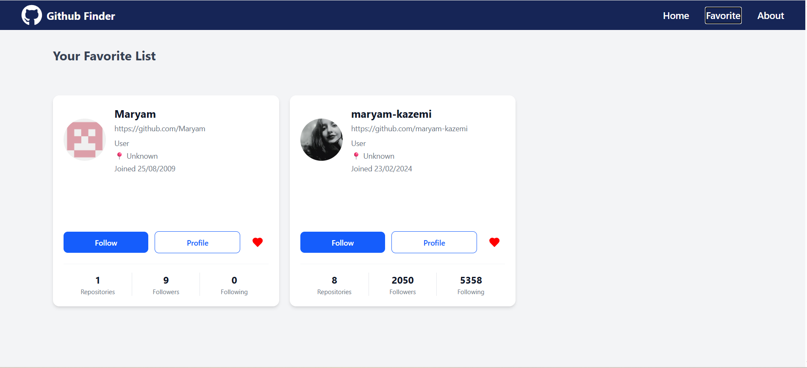
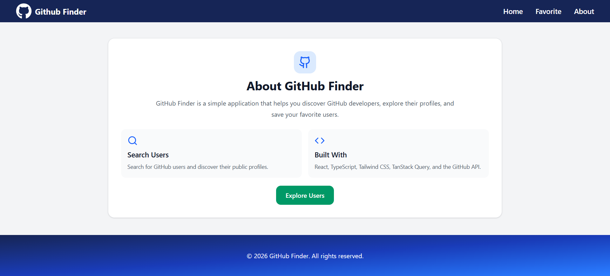

# GitHub User Finder

A responsive web application for searching GitHub users, exploring developer profiles, discovering popular developers, and managing favorite users.

**Live Demo:** [View Project](https://mrm-jamali.github.io/github-user-finder/)

## Overview

GitHub User Finder is a React application built with TypeScript and TanStack Query that integrates with the GitHub REST API to search for developers, explore user profiles, discover popular GitHub users, and manage favorites.

The project focuses on efficient server-state management, API integration, pagination, caching, and persistent state.

## Screenshots

### Home Page


### Favorite Page



### About Page



## Features

- **User Search:** Search for GitHub users by entering a query and clicking the Search button.
- **Infinite Pagination:** Fetch additional search results using TanStack Query's `useInfiniteQuery` and a Load More feature.
- **Popular Users:** Discover popular developers ranked by follower count.
- **User Details:** Explore GitHub profiles, including followers, following, public repositories, location, and account creation date.
- **Favorites Management:** Add and remove users from favorites by clicking the heart icon.
- **Persistent Favorites:** Store favorite users in `localStorage` so they remain available after page refreshes and browser restarts.
- **Persistent Search:** Preserve the search input using `sessionStorage` and restore cached search results after page refreshes using TanStack Query cache persistence.
- **Query Caching:** Cache API responses and reuse cached data for matching searches when available.
- **Loading and Error States:** Handle API loading and error scenarios.
- **Responsive UI:** Provide a responsive interface for different screen sizes.
- **Routing:** Navigate between Home, Favorites, and About pages.

## Tech Stack

- React
- TypeScript
- Tailwind CSS
- TanStack Query
- Axios
- React Router
- React Context API
- React Icons
- GitHub REST API
- Vite

## Key Technical Highlights

- Implemented paginated data fetching with `useInfiniteQuery`.
- Used query keys to manage cached results for different search queries.
- Configured TanStack Query cache persistence to restore cached data after page refreshes.
- Separated input state from submitted search state to control when search requests are executed.
- Used `sessionStorage` to preserve the search input across page refreshes within the browser session.
- Managed shared favorite state using React Context.
- Implemented favorite toggling to add or remove users through an interactive heart icon.
- Persisted favorite users in `localStorage`.
- Integrated GitHub API endpoints through reusable Axios functions.
- Built reusable React components with responsive Tailwind CSS styling.

## Getting Started

### Prerequisites

- Node.js
- npm

### Installation

Clone the repository:

```bash
git clone https://github.com/mrm-jamali/github-user-finder.git
```

Navigate to the project directory:

```bash
cd github-user-finder
```

Install dependencies:

```bash
npm install
```

Start the development server:

```bash
npm run dev
```

Open the local URL provided by Vite in your browser.

## API

This project uses the GitHub REST API.

- [GitHub REST API Documentation](https://docs.github.com/en/rest)
- [GitHub User Search API](https://api.github.com/search/users?q=react)

Unauthenticated GitHub API requests are subject to rate limits.

## What I Learned

- Implementing infinite queries and pagination with TanStack Query.
- Managing server state, query caching, and cache persistence.
- Controlling API requests with separate input and submitted search states.
- Persisting search input and favorite users using browser storage.
- Managing shared state with React Context.
- Integrating REST APIs using Axios.
- Building reusable, responsive React components.
- Handling API loading states, errors, and cached data.

## Author

**Maryam Jamali**

- [GitHub Profile](https://github.com/mrm-jamali)
- [LinkedIn Profile](https://www.linkedin.com/in/maryam-jamalii/)